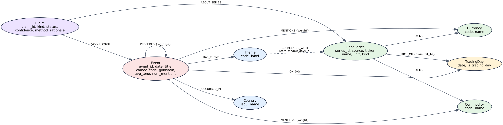

# Event-Market Graph

[](https://github.com/adrienlabergere-creator/graphdb-event-market/actions/workflows/lint.yml)
[](https://github.com/adrienlabergere-creator/graphdb-event-market/actions/workflows/tests.yml)

> **Disclaimer:** educational and analytical purposes only. This project gives no financial advice and never executes orders. A temporal correlation between an event and a market move is never presented as proof of causation.

## Project description

Subject 10 of the GraphDB projects (level 3+): geopolitical events and market moves in one Neo4j graph.

- Events come from GDELT (tension events by country) and from central-bank rate decisions; prices come from FRED (Brent, WTI, EURUSD, USDJPY, US 10-year yield, VIX).
- Events and prices meet on a shared `TradingDay` node, so the graph can show what happened in the days before a move.
- The API computes correlations, candidate events for a move, shortest paths and PageRank (Graph Data Science).
- A LangGraph agent answers questions in natural language, shows the graph paths and the Cypher it used, and marks every correlation as a hypothesis, never as a cause.
- Window: February to July 2026.

## Installation and execution

```bash
cp .env.example .env        # then set local values
make docker-run             # Neo4j, local LLM runtime, API, reverse proxy
make help                   # all commands
```

Load the data (Neo4j must be running and `.env` filled):

```bash
make schema                 # constraints and indexes
make ingest                 # FRED prices and GDELT events (a few minutes, idempotent)
make stats                  # counts by label and relationship
```

Run the API locally and open Swagger at http://localhost:8000/docs:

```bash
make run
```

The agent (`POST /api/ask`) needs a model served by Ollama: set `LLM_MODEL` in `.env`. Without it the endpoint answers 503.

## API examples

Swagger is available at `/docs`. List endpoints accept `limit` (default 20, maximum 100) and `offset`.

```bash
# Correlations between event themes and Brent (a theme code or a series id)
curl "http://localhost:8000/api/correlation/event-market?entity=BRENT&window=90&limit=5"

# Largest move of the US 10-year yield and the events that preceded it
curl "http://localhost:8000/api/explain/move?asset=US10Y&window=90"

# Ask the agent
curl -X POST http://localhost:8000/api/ask -H "Content-Type: application/json" \
  -d '{"question": "Why did the VIX move in June?"}'
```

Every correlation or explanation carries `"status": "hypothesis"` and a `disclaimer`. The other endpoints are `GET /api/timeline/{asset}`, `GET /api/events/{event_id}/paths` and `GET /api/graph/centrality`.

Error codes: 404 for an unknown series, theme or event, 422 for an invalid parameter, 503 when Neo4j, the GDS plugin or the model runtime cannot be reached.

## Screenshots

Added in stage 4 (infrastructure): Swagger, the Neo4j Browser graph view and an agent answer with its graph paths, in `docs/screenshots/`.

## Graph schema



Eight labels: `Event`, `Country`, `Theme`, `Commodity`, `Currency`, `PriceSeries`, `TradingDay`, `Claim`. Events are linked to their country (`OCCURRED_IN`), their category (`HAS_THEME`) and what they mention (`MENTIONS`); prices hang off `(:PriceSeries)-[:PRICE_ON {close, ret_1d}]->(:TradingDay)`. Events and prices meet on `TradingDay`, which is the join between the two worlds. A measured statistic is stored on `(:Theme)-[:CORRELATES_WITH]->(:PriceSeries)` with its window and sample size, and a relation proposed by the ML workflow becomes a `Claim` node with a status and a confidence, never a plain edge. Full contract: [docs/GRAPH_CONTRACT.md](docs/GRAPH_CONTRACT.md).

## System architecture

Added in stage 4 (infrastructure): `docs/architecture.png` with the services, their ports and the data flows. Today the stack is Neo4j (with the GDS plugin), the FastAPI application, an Ollama runtime for the model and an Nginx reverse proxy, all started by `make docker-run`.

## Dataset sources

Two public sources, February to July 2026: **GDELT** for geopolitical events (CAMEO root codes 13 to 19, 30 countries, the 25 most mentioned events per day) and **FRED** for daily prices (Brent, WTI, EURUSD, USDJPY, US 10-year yield, VIX). Central-bank events are derived from the Fed and ECB policy-rate series rather than hand-written. About 4,500 events and 880 price points, rebuilt by anyone with `make ingest`. Sources, filters, licences and exact commands: [docs/DATASETS.md](docs/DATASETS.md).

## Modeling rationale

Why `TradingDay` is a node and not a date property, why a `Claim` is a node rather than a relationship property, why the price sits on the relationship instead of an `Observation` node, which alternatives were rejected and how the model differs from a schema an AI assistant generates from the project description: [docs/modeling_rationale.md](docs/modeling_rationale.md), including the anti-genericity appendix.

## LLM guardrails

The agent only calls four tools (`graph_query`, `correlation`, `timeline`, `explain_move`). Generated Cypher is read-only, checked against the graph contract, bounded in depth and `LIMIT`, and runs with a timeout. Answers are structured, marked `verified` or `hypothesis`, and never worded as a cause. Requests for financial advice are refused. Details: [docs/llm_guardrails.md](docs/llm_guardrails.md).

## Makefile usage

| Command | What it does |
|---|---|
| `make help` | Lists all commands |
| `make install` | Creates `.venv` and installs requirements |
| `make run` | Runs the API locally on port 8000 |
| `make docker-run` | Starts the whole Docker Compose stack |
| `make status` | Where the project stands, next task (`WHO=Firstname`) |
| `make test` | Runs pytest with coverage |
| `make lint` | Runs pylint (score at least 9.5) |
| `make clean` | Removes caches |

## Docker image

Published in stage 4 (infrastructure): link to the image on a public registry.

## Team contributions

Filled in at the rehearsal stage from `git shortlog -sn` and the merged pull requests.

| Member | Commits | Share | Pull requests | Role |
|---|---|---|---|---|
| Adrien | | | | |
| Edgar | | | | |
| Louis | | | | |
| Oscar | | | | |
| Victor | | | | |
